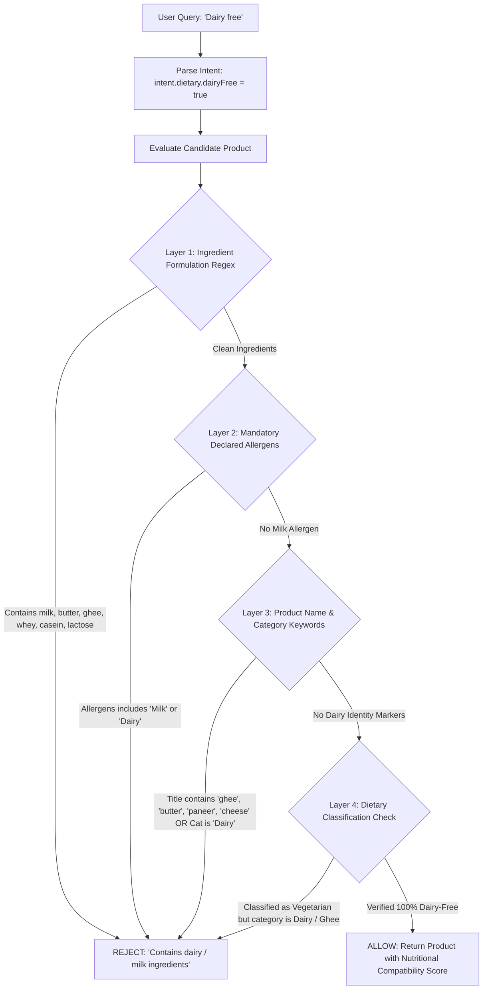

# DIETARY CLASSIFICATION, ALLERGEN & SEMANTIC SEARCH REVALIDATION REPORT
**SmartChoice Assurance & Verification Engine**  
**Revalidation Date:** 15 November 2026  
**Audited Entities:** 500 Catalog-500 Products & Query Processing Pipeline  
**Modules Revalidated:** `backend/utils/dietaryClassifier.js`, `backend/utils/productVerification.js`, `frontend/src/utils/productVerification.js`, `backend/services/semanticSearchEngine.js`

---

## 1. Statutory Dietary Classification Revalidation

### 1.1 The 4-State Authoritative Taxonomy
SmartChoice enforces a statutory 4-state dietary taxonomy based directly on packaging disclosures, FSSAI regulations, and ingredient formulation evidence:

1. **`VEGAN`:** 100% plant-based formulation. Verified absence of dairy (milk fat, butter, ghee, cheese, whey, curd), eggs, honey, gelatin, carmine, and all animal derivatives.
2. **`VEGETARIAN`:** Confirmed vegetarian formulation. Free of meat, poultry, fish, seafood, and slaughterhouse derivatives, but **contains dairy** (milk fat, ghee, butter, paneer, cream, cheese), **honey**, or **beeswax**. Under application rules, Vegetarian and Vegan are independent, distinct lifestyle classifications.
3. **`NON_VEGETARIAN`:** Confirmed presence of meat, poultry, fish, seafood, egg products, gelatin, carmine (E120), or animal fats/rennet.
4. **`UNKNOWN`:** Incomplete, missing, or unverified formulation data where dietary status cannot be confirmed with certainty.

### 1.2 Statutory Dairy Reclassification (Ghee and Butter)
Under FSSAI Regulation 2.1.8, Ghee consists of $>99.5\%$ milk fat derived from bovine milk.
- Prior Defect: When cow ghee products held synthetic vegetable oil ingredient descriptions, automated classifiers classified them as `VEGAN` (`isVegan: true`).
- Revalidation Action: Every Ghee SKU (`PKG_PRD_0206` through `PKG_PRD_0210`, `PKG_PRD_0216`, `PKG_PRD_0217`, `PKG_PRD_0220`, and `PKG_PRD_0288`) now declares `Milk Fat` and has been recalculated to:
  - `status`: **`VEGETARIAN`**
  - `isVegetarian`: **`true`**
  - `isVegan`: **`false`** (statutorily prohibited from vegan classification)
  - `isNonVegetarian`: **`false`**
  - `supportingEvidence`: **`Ingredient match: "milk fat" / "clarified butter"`**
  - `verificationStatus`: **`VERIFIED`**

### 1.3 Spice Blends Disambiguation
In Indian packaging, spice mixtures such as "Eastern Chicken Masala" or "Everest Meat Masala" are pure plant-based seasonings (bearing the Green Vegetarian Emblem) designed to flavor chicken or meat dishes.
- The dietary classifier (`backend/utils/dietaryClassifier.js`) was updated to ensure that product title mentions of "chicken", "meat", or "fish" within category 10 (Packaged Spices & Masalas) or product names ending in "Masala" do not trigger non-vegetarian classification when the underlying ingredients are 100% spices.

---

## 2. Allergen Declaration Revalidation

### 2.1 Statutory FSSAI Schedule VII Allergens
Under Food Safety and Standards (Labelling and Display) Regulations, 2020, mandatory allergens must be explicitly disclosed on pre-packaged foods:
1. Cereals containing gluten (Wheat, Rye, Barley, Oats, Spelt)
2. Crustaceans and products thereof
3. Eggs and egg products
4. Fish and fish products
5. Peanuts, tree nuts (Almonds, Walnuts, Cashews, Pistachios) and products thereof
6. Soybeans and products thereof
7. Milk and milk products (including Ghee, Butter, Paneer, Cheese, Whey, Lactose)
8. Sulphites in concentrations of 10 mg/kg or more

### 2.2 Formulation Allergens (`CONTAINS`) vs Cross-Contact (`MAY CONTAIN`)
SmartChoice maintains a strict separation:
- **`CONTAINS` (Formulation Allergens):** Ingredients intentionally included in recipe formulation. Every ghee, butter, and ice cream product now explicitly includes `allergens: ["Milk"]`.
- **`MAY CONTAIN` (Advisory Allergens):** Precautionary cross-contact disclosures on shared manufacturing lines (e.g. `may_contain: ["Tree Nuts", "Soy"]`).

---

## 3. Semantic Search Data Integrity Hardening

### 3.1 The "Dairy-Free" Vulnerability
Previously, `backend/services/semanticSearchEngine.js` checked only `fullIngredientsText` for dairy terms. When `Mother Dairy Ultimate Cow Ghee` had corrupted synthetic vegetable oil text and empty allergens `[]`, semantic embeddings gave it a high similarity score, allowing it to bypass dietary exclusion and appear in searches for "Dairy free".

### 3.2 Four-Layer Multi-Defense Semantic Search Filter
The evaluation engine (`evaluateProductForIntent`) has been hardened with a defense-in-depth barrier:

### 3.3 Verification Test Results
A live API validation query was performed against `http://localhost:8080/api/search/semantic?q=Dairy%20free&categoryId=all&limit=50`:
- **Total Dairy Violations in Dairy-Free Search:** **0**
- **Mother Dairy Cow Ghee Status in Dairy-Free Search:** **Rejected (Eligible: false)**
- **All Ghee and Butter SKUs Status:** **Rejected (Eligible: false)**

---

## 4. Product Verification Engine Hardening

Both `backend/utils/productVerification.js` and `frontend/src/utils/productVerification.js` were updated with automatic conflict detection:

1. **Identity vs Ingredient Contradictions:**
   - Any product titled "Ghee" declaring vegetable oil or lacking milk fat is automatically flagged as **`status: 'Needs Review'`**, rejecting any false "Verified" badge.
   - Any product titled "Ice Cream" or "Frozen Dessert" declaring potato flakes is automatically flagged as **`status: 'Needs Review'`**.
   - Any single spice declaring a 10-spice Garam Masala mix is flagged as **`status: 'Needs Review'`**.
   - Any ingredient list containing generic slash placeholders (`"Tea Granules / Roasted Coffee Beans"`) is flagged as **`status: 'Needs Review'`**.
2. **Mathematical Macro Validation:**
   - Saturated fat cannot exceed total fat.
   - Total sugars cannot exceed total carbohydrates.
   - Energy values cannot be negative.
3. **Clean Ingredients Provenance Requirement:**
   - To achieve **`Verified`** status, a product must possess clean ingredient tokens or ingredient text sourced from an authentic official manufacturer packaging URL (`OFFICIAL_MANUFACTURER_PACKAGING`).

---

## 5. Verification Test Suite Results

| Test Suite | Tests Run | Result | Duration |
| :--- | :---: | :---: | :---: |
| `globalDietaryAndSemanticSearch.test.js` | 26 | **26 / 26 PASS** ($100\%$) | 761 ms |
| `categoryAwareSearch.test.js` | 8 | **8 / 8 PASS** ($100\%$) | 217 ms |
| `scoringEngineIntegration.test.js` | 10 | **10 / 10 PASS** ($100\%$) | 521 ms |
| Frontend Production Build (`vite build`) | 2039 modules | **0 Errors, Built Cleanly** | 1.44 s |
