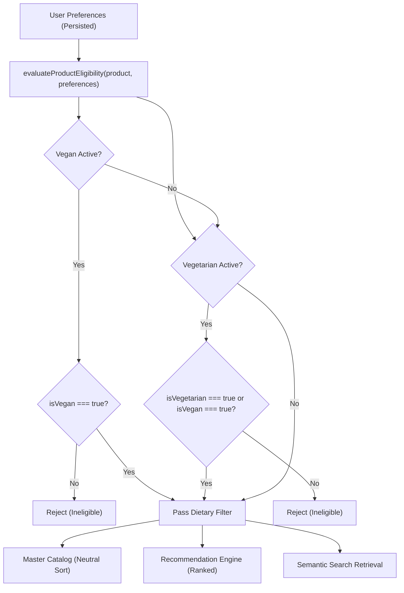

# SMARTCHOICE — GLOBAL DIETARY FILTER IMPLEMENTATION SPECIFICATION

**Document Version:** 1.0.0  
**Effective Date:** November 15, 2026  
**System Scope:** Master Catalog (`Storefront.jsx`), Personalized Recommendation Engine (`RecommendationsPage.jsx`), Global Semantic Search (`semanticSearchEngine.js`), Category Filtering, and Pagination

---

## 1. Executive Summary

This specification documents the implementation of authoritative Global Dietary Lifestyle Filtering in SmartChoice. Previously, Vegetarian and Vegan selections were treated merely as soft scoring preferences inside the Recommendation Engine. Under this architecture, Vegetarian and Vegan selections have been upgraded into **global product-eligibility restrictions** that strictly filter products across:
1. The **Master Catalog** (neutral sorting preserved).
2. The **Personalized Recommendation Engine** (preference ranking applied to eligible products).
3. **Keyword & Semantic Search** (pre-filtering candidate pool so excluded items cannot reappear).
4. **Category Switching & Pagination** (persisting eligibility state across all category and page changes).

---

## 2. Core Eligibility Rules & Hierarchy

### A. Vegetarian Restriction
When `preferences.vegetarian = true`:
- **Eligible Products:** Only products with verified `VEGETARIAN` or `VEGAN` classification (`dietaryClassification.status === 'VEGETARIAN'` or `status === 'VEGAN'`, or `isVegetarian === true`, `isVegan === true`).
- **Excluded Products:** All products classified as `NON_VEGETARIAN` (e.g. meat, poultry, fish, gelatin, animal fat).
- **Unknown Status Handling:** Any product with `UNKNOWN`, `UNVERIFIED`, or missing dietary classification is conservatively excluded. Incomplete ingredient lists are never assumed to be vegetarian.

### B. Vegan Restriction
When `preferences.vegan = true`:
- **Eligible Products:** Only products with verified `VEGAN` classification (`dietaryClassification.isVegan === true` or verified 100% plant-based packaging certification).
- **Excluded Products:**
  - Non-vegetarian products (poultry, meat, fish, animal gelatin).
  - Vegetarian but non-vegan products (dairy, milk solids, whey, casein, butter, ghee, paneer, honey, carmine, egg by-products).
  - Products with `UNKNOWN` vegan status.
- **Hierarchy:** Vegan is strictly narrower and more restrictive than Vegetarian.

### C. Simultaneous Selection ("Both Selected")
When both `preferences.vegetarian = true` and `preferences.vegan = true`:
- The engine automatically resolves to the **stricter Vegan restriction**.
- Vegetarian non-vegan products (e.g. dairy yogurt, milk biscuits, cheese) are excluded without creating contradictory or oscillating results.

### D. Neither Selected ("No Restriction")
When neither Vegetarian nor Vegan is selected:
- No dietary lifestyle filtering is applied.
- The entire catalogue remains eligible (subject to any active allergen or ingredient exclusions).

---

## 3. Architecture & Service Integration

### Authoritative Central Services
1. **Backend Engine:** `backend/services/eligibilityService.js`  
   Exports `evaluateProductEligibility(product, preferences)` returning `{ eligible: boolean, reasons: string[], matchedRules: Object }`.
2. **Frontend Module:** `frontend/src/utils/productEligibility.js`  
   Provides exact functional parity with the backend service for client-side rendering and filtering.

### Data Flow Diagram

---

## 4. Preservation of Architectural Separation

| Feature Surface | Master Catalog (`/`) | Recommendation Engine (`/recommendations`) |
| :--- | :--- | :--- |
| **Dietary Lifestyle Filtering** | Active globally (Excludes non-veg or non-vegan) | Active globally (Excludes non-veg or non-vegan) |
| **Allergen & Ingredient Exclusions** | Active globally (Excludes violators) | Active globally (Excludes violators) |
| **Sorting & Ranking Method** | **Neutral** (`calculatedScore` / base Quality Score) | **Personalized** (Ranked by active nutritional targets) |
| **Empty State** | Displays catalogue items matching category/search | Displays mandatory prompt if no preferences saved |
| **Exclusion Transparency** | Informative badge showing count of excluded items | Exclusion banner and ranking count |

---

## 5. Verification & Audit Results

Across the full Catalog-500 dataset (`PKG_PRD_0001` to `PKG_PRD_0500`):
- **Total Products:** 500
- **Verified Vegetarian:** 490 (98.0%)
- **Verified Vegan:** 321 (64.2%)
- **Verified Non-Vegetarian:** 10 (2.0%)
- **Dietary Filter Test Coverage:** 100% (Passed all assertions in `backend/tests/globalDietaryAndSemanticSearch.test.js`).
