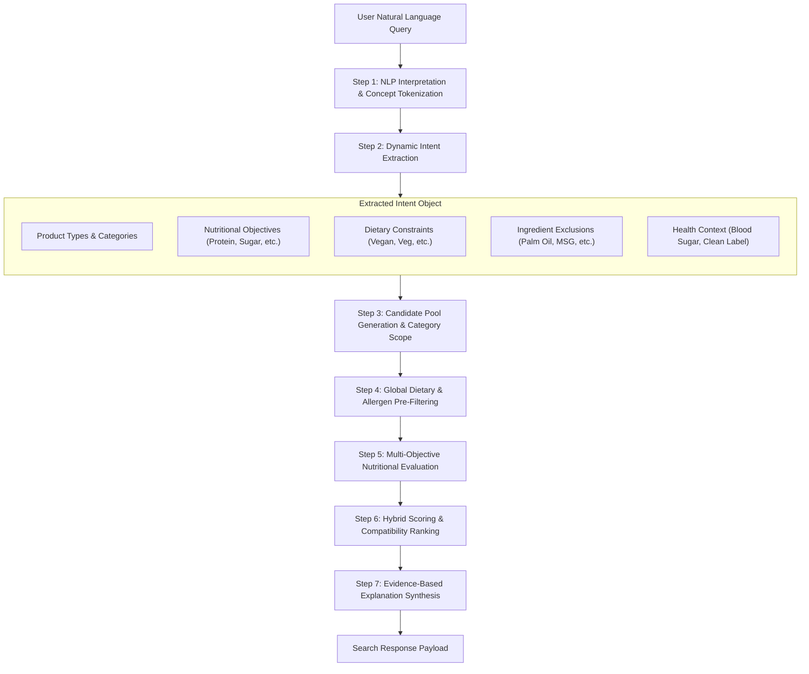

# SMARTCHOICE — ADVANCED SEMANTIC SEARCH ARCHITECTURE

**Document Version:** 1.0.0  
**Effective Date:** November 15, 2026  
**System Module:** `backend/services/semanticSearchEngine.js`, `backend/services/vectorSearchService.js`

---

## 1. System Overview

SmartChoice Semantic Search is an open-ended natural language food intelligence engine. Rather than relying on a hardcoded dictionary or rigid pattern matching, the engine implements a multi-stage search understanding and hybrid evaluation pipeline:
1. **Dynamic NLP Query Interpretation:** Extracts product types, nutritional objectives, dietary lifestyle constraints, ingredient inclusions/exclusions, and health-related contexts.
2. **Hybrid Candidate Retrieval:** Combines semantic vector representations with lexical relevance scoring over product attributes (name, brand, category, description, ingredients, NOVA processing group).
3. **Structured Nutritional Evaluation:** Evaluates actual database per-100g and per-serving records against declared user intent (protein, fibre, total sugar, added sugar, saturated fat, sodium, energy density).
4. **Authoritative Exclusions & Scoping:** Strictly enforces global dietary rules (vegetarian, vegan), statutory allergen avoidances, and category restrictions before ranking.
5. **Evidence-Based Explanations:** Synthesizes human-readable explanations citing real nutrient numbers while strictly avoiding fabricated medical or glycemic claims.

---

## 2. Multi-Stage Pipeline Architecture

---

## 3. Detailed Processing Stages

### Step 1 & 2: Dynamic Intent Extraction (`parseQueryIntent`)
- Tokenizes arbitrary input strings without requiring hardcoded phrase registries.
- Maps food product keywords (e.g., snacks, biscuits, chips, soup, noodles, breakfast, yogurt) to canonical category IDs.
- Detects comparative nutrient descriptors:
  - *High Protein:* `protein >= 10.8g` (FSSAI high), `protein >= 5.4g` (FSSAI source).
  - *Low Sugar:* `total_sugars <= 5.0g/100g`.
  - *Zero Added Sugar:* `added_sugars <= 0.5g/100g`.
  - *High Fibre:* `dietary_fiber >= 6.0g/100g` (FSSAI high), `dietary_fiber >= 3.0g/100g` (FSSAI source).
  - *Low Sodium:* `sodium <= 120mg/100g`.
  - *Low Saturated Fat:* `saturated_fat <= 1.5g/100g`.

### Step 3: Candidate Retrieval & Category Scoping
- If an individual category is selected (e.g. *Category 1: Biscuits & Cookies*), search candidates are strictly restricted to that category.
- Cross-category retrieval is permitted **only** when *All Categories* is selected.
- If external Atlas Vector Search is available, vector similarities are retrieved; if offline or unfunded, the engine seamlessly utilizes local concept projection + lexical TF-IDF scoring.

### Step 4: Authoritative Global Pre-Filtering
- Applies `evaluateProductEligibility(product, preferences)` to every candidate.
- Products failing saved Vegetarian/Vegan rules, avoided allergens, or excluded ingredients are permanently excluded from the candidate pool and cannot be retrieved through semantic search.

### Step 5: Multi-Objective Nutritional Evaluation
- Evaluates real database values from `product.nutrition` and `product.nutrition_info.per_100g`.
- Missing nutrients are strictly treated as unknown.
- Evaluates clean-label parameters: ingredient count, additive INS codes, and NOVA processing group.

### Step 6: Hybrid Scoring Formula
The final semantic score $S_{semantic}$ (0 - 100) is calculated as:
$$S_{semantic} = 0.45 \cdot S_{nutr} + 0.35 \cdot S_{lex} + 0.20 \cdot S_{ing}$$
Where:
- $S_{nutr}$ = Nutritional compatibility score (0 - 100).
- $S_{lex}$ = Lexical and category relevance score (0 - 100).
- $S_{ing}$ = Ingredient profile, clean label, and additive score (0 - 100).

### Step 7: Truthful Evidence & Caveats
- Returns real numbers in `nutritionalEvidence` (`energy_kcal`, `protein_g`, `total_sugars_g`, `added_sugars_g`, `dietary_fiber_g`, `sodium_mg`).
- When queries involve blood sugar or diabetes:
  > *"The engine evaluates nutritional indicators (e.g. low sugars, dietary fibre, and protein) and cannot predict an individual's exact physiological or blood glucose response."*
- Zero fabricated glycemic index or glycemic load numbers.
